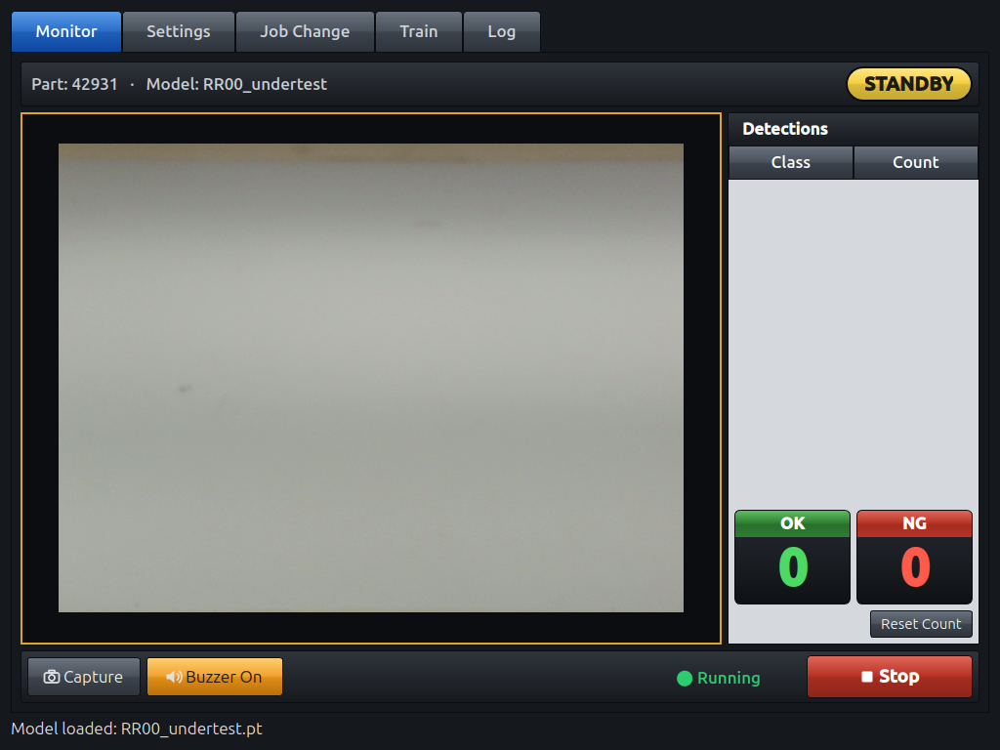
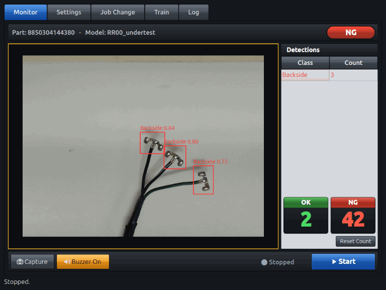
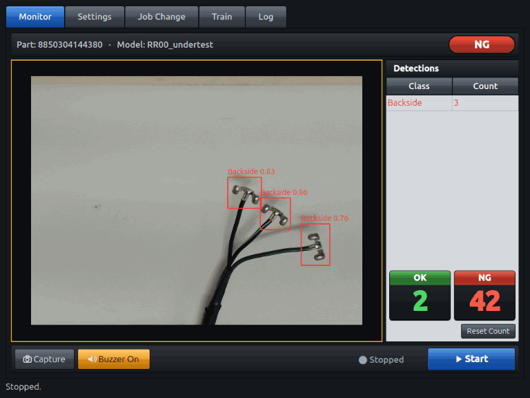
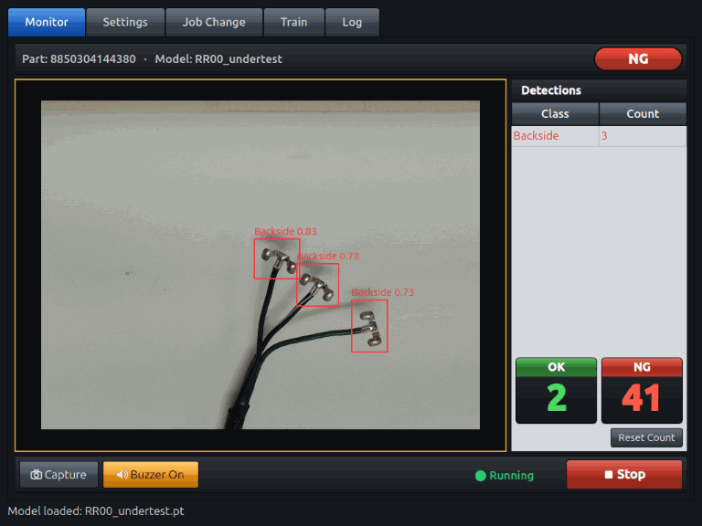
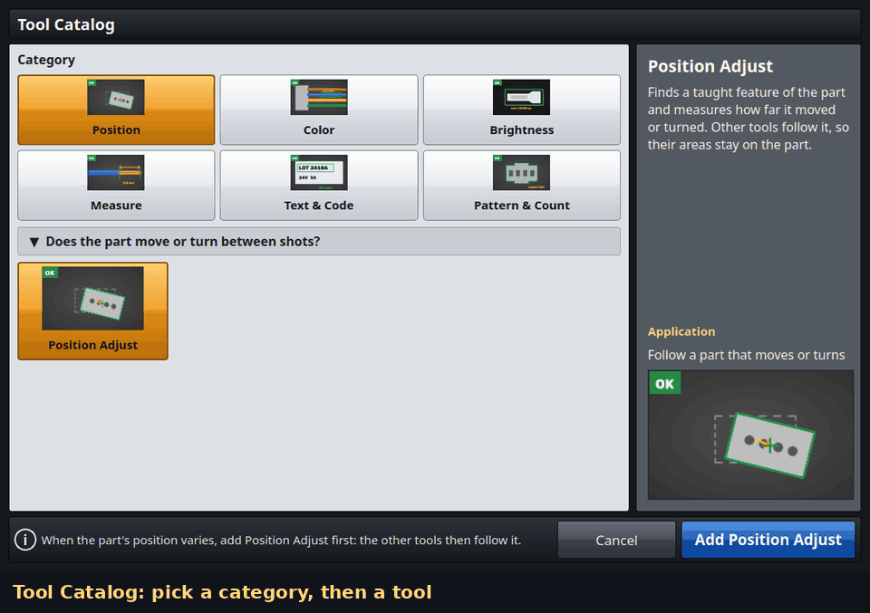
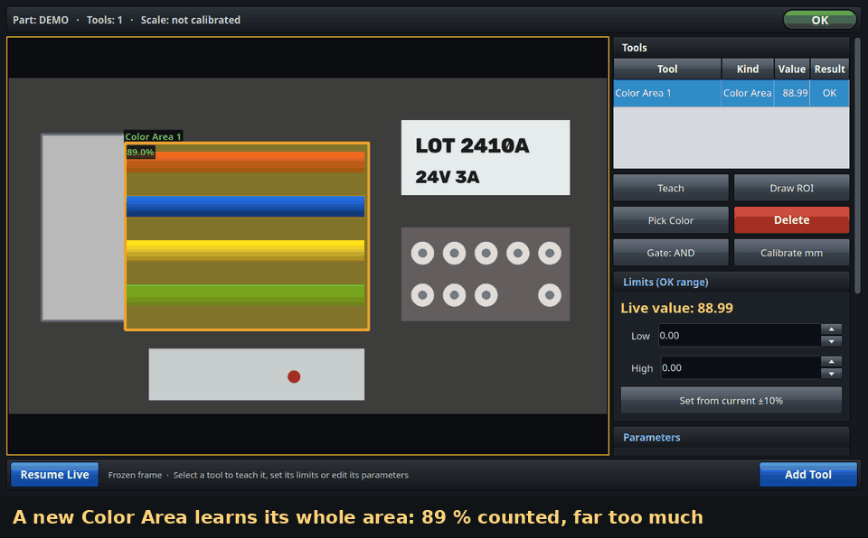
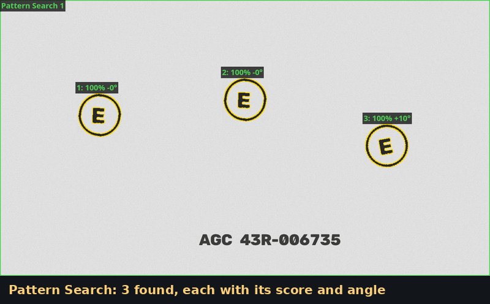
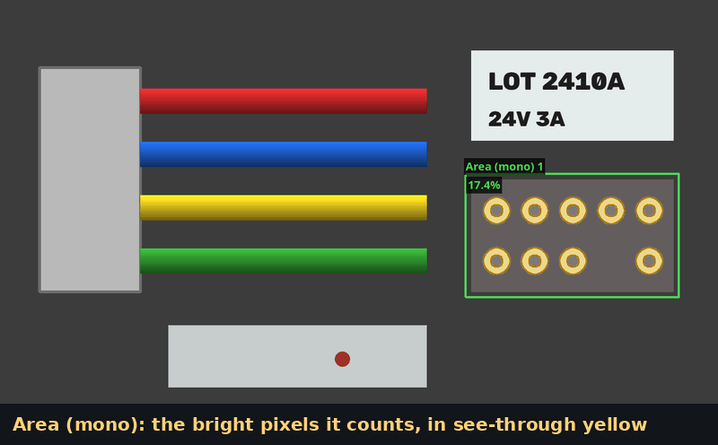

# UniversalV1 — Wire Harness Vision Inspection

**English** · [ภาษาไทย](#ภาษาไทย)

A Keyence-style inspection station for wire harnesses. A USB camera and a YOLO model decide **OK / NG / STANDBY**, and a PATLITE tower light and buzzer signal the result. It runs as a full-screen touch kiosk on an NVIDIA Jetson Orin Nano.



📘 **User manual:** [English](docs/USER_MANUAL_EN.md) · [ภาษาไทย](docs/USER_MANUAL_TH.md)

## See it in action

Recorded on the real station, with the live camera and a real harness.

| 1. Switch job by barcode | 2. Review NG pictures |
|---|---|
|  |  |
| **Job Change → Scan Barcode...**: hold the label on the red line. The part number is read, and the job is loaded or created. | **Log** tab: tap a thumbnail, pinch with two fingers to zoom on the detections, double-tap to fit. |
| **3. Adjust detection settings** | **4. Correct labels for training** |
|  |  |
| **Settings** tab: confidence, max detections and state hold time take effect immediately on the live view. | **Train** tab: pick an image, tap a box, choose the right class, **Confirm**. |

## Image-processing tools (Keyence IV4 / CV-X style)

Next to YOLO, each job can hold rule-based **vision tools**. They work like the tools of a Keyence IV4 / CV-X vision sensor: each one checks one thing in its own area of the image, and together they decide OK / NG (gate **AND** or **OR**, together with YOLO). They are set up in the **Tools** tab.

| 1. Tool Catalog | 2. Eyedropper (Pick Color / Pick Gray) |
|---|---|
|  |  |
| **Add Tool** opens the catalog. Tap a category, then a tool: the **Application Navigator** on the right explains it with an example. **Add** (or a double tap) confirms, then you drag the tool's area on the image. | Tap the color (or gray level) to count on the image, and tap more spots to add them. **− Narrower / + Wider** adjust it in steps. What is counted is shown live in yellow. |
| **3. Pattern Search** | **4. What each tool counts** |
|  |  |
| Teach one mark (drag a box around it). Every copy is then found at any angle and counted, with its score and angle. | Area, Edge Pixels, Blob Count and Color Prohibit show exactly the pixels they count: see-through yellow, or red for a forbidden color. |

| Category | Tools |
|---|---|
| Position | **Position Adjust**: finds the part, and the other tools follow it when it moves or turns |
| Color | **Color Area** (% of the taught color), **Color Average** (ΔE to the master), **Color Prohibit** (NG on a forbidden color) |
| Brightness | **Area (mono)**, **Brightness Average**, **Edge Pixels**, **Shading Uniformity** |
| Measure | **Width**, **Edge Presence**, **Pitch**, **Diameter** (px, or mm after **Calibrate mm**) |
| Text & Code | **OCR Text** (Tesseract), **Code QR / 1D** (zbar). They run at 2 Hz in their own thread, so the live view stays at full frame rate. |
| Pattern & Count | **Outline**, **Pattern Search** (ShapeTrax-style, any angle), **Blob Count** |

How to set up a tool:
1. **Tools** tab. The camera starts live; **Snapshot** freezes a frame and **Resume Live** goes back.
2. **Add Tool** → pick it in the catalog → drag its area on the image. Pattern Search then asks for a box around one copy of the pattern.
3. **Teach** (from the frozen frame), or **Pick Color / Pick Gray** for the color and brightness tools.
4. Set the OK range under **Limits**. **Set from current ±10 %** is a quick start. Tools are saved with the job and judged live on the Monitor tab.

The tool design and the per-tool details are in [core_function.md](core_function.md); the development log is in [develop_record.md](develop_record.md). The GIFs above are drawn scenes recorded offscreen by `tools/make_readme_gifs.py`.

## Features

- **Live detection:** Ultralytics YOLO runs on the Jetson GPU (CUDA). You can filter by confidence, class and a maximum number of detections.
- **Judgement and outputs:**
  - OK / NG / STANDBY, using one or two target classes combined with AND / OR.
  - PATLITE LR6-USB tower light: green = OK, red = NG, yellow = STANDBY.
  - NG alarm buzzer, with a short beep on OK.
  - A state hold time (default 1 s) stops the light and buzzer from flickering.
- **OK / NG cycle counters:** large tiles that are saved across restarts.
- **Log tab:**
  - Every NG is saved as an image, grouped by part number.
  - Thumbnails open a full-screen view with pinch-to-zoom.
- **Job Change:**
  - One job per part number stores the model, filters and target classes.
  - Jobs are switched with touch tiles or a barcode scanned by the camera (Code 39 / AIM extended).
- **Capture and Train:**
  - **Capture** saves frames with YOLO labels.
  - The Train tab lets you correct a box's class and fine-tune the model on the device.
- **Kiosk mode:**
  - Starts full screen on boot through a systemd user service.
  - Reloads the last job automatically.

## Hardware

| Item | Used here |
|---|---|
| Computer | NVIDIA Jetson Orin Nano (JetPack, CUDA 13) |
| Camera | USB UVC camera (V4L2) |
| Tower light | PATLITE LR6-USB (VID `191a`, PID `8003`) |
| Display | 1024×768 touch panel (ILITEK multi-touch) |

## Installation

```bash
git clone https://github.com/natn2014/UniversalV1.git
cd UniversalV1

# System libraries: barcode / QR decoding, and the OCR engine for the OCR tool
sudo apt install libzbar0 tesseract-ocr

# Python environment
python3 -m venv .venv
source .venv/bin/activate

# 1) Install CUDA-enabled torch FIRST (matches the Jetson's CUDA)
pip install torch torchvision --index-url https://pypi.org/simple
# 2) Then the rest
pip install -r requirements.txt
```

> Install `opencv-python-headless`, not `opencv-python`. The non-headless build brings its own Qt plugins, and they clash with PySide6.

### Tower light permissions (udev)

```bash
sudo cp deploy/99-patlite-lr6.rules /etc/udev/rules.d/
sudo udevadm control --reload-rules && sudo udevadm trigger
sudo usermod -aG plugdev $USER    # log out/in afterwards
```

## Running

```bash
source .venv/bin/activate
python3 main.py
```

The window opens full screen. Choose a model and camera in **Settings**, or pick a job in **Job Change**, then press **Start** on the Monitor tab.

## Kiosk autostart (boot → app)

1. Install the user service:

   ```bash
   mkdir -p ~/.config/systemd/user
   cp deploy/wire-harness-detector.service ~/.config/systemd/user/
   systemctl --user daemon-reload
   systemctl --user enable --now wire-harness-detector.service
   ```

   The service file contains absolute paths (`/home/orin_nano/dev/Wire_harness_module`). Edit them if you clone the repo somewhere else.

2. Enable automatic login, so the desktop session and the app start without a keyboard. In `/etc/gdm3/custom.conf`, under `[daemon]`:

   ```ini
   AutomaticLoginEnable = true
   AutomaticLogin = orin_nano
   ```

3. Useful commands:

   ```bash
   systemctl --user status  wire-harness-detector.service
   systemctl --user restart wire-harness-detector.service
   systemctl --user stop    wire-harness-detector.service   # before running main.py by hand
   journalctl --user -u wire-harness-detector.service -f    # live log
   ```

Only one copy of the app can use the camera and tower light at a time. Stop the service before starting `main.py` manually.

## Project layout

| Path | Purpose |
|---|---|
| `main.py` | Entry point (`python3 main.py`); the application lives in `app/` |
| `app/main_window.py` | Main window: hosts the tabs and the cross-tab flows (switching jobs, barcode scan, shutdown) |
| `app/tabs/` | One widget per tab: Monitor, Settings, Tools, Job Change, Train, Log |
| `app/vision/` | Rule-based vision tools (no Qt): position, color, brightness, measure, OCR / code, outline, pattern search, blob count; the slow-tool thread and the total judgement |
| `app/context.py` | `AppContext`: state the tabs share (video worker, filters, current part, model, settings, tower light) |
| `app/camera.py`, `app/tower.py`, `app/judgement.py` | Camera + YOLO worker, tower light/buzzer controller, OK/NG decision and hold-time latch |
| `app/jobs.py`, `app/ng_log.py`, `app/settings.py`, `app/paths.py` | Saved jobs, NG image log, `app_settings.json`, data paths |
| `app/widgets/`, `app/theme.py` | Reusable widgets and dialogs; dark industrial stylesheet and icons |
| `patlite_lr6.py` | PATLITE LR6-USB driver (from [TowerLightUSB](https://github.com/natn2014/TowerLightUSB)) |
| `part_configs/<part>.json` | Saved jobs, one per part number |
| `*.pt`, `weights/` | YOLO models |
| `deploy/` | systemd service and udev rule |
| `docs/` | User manuals, screenshots and demo GIFs (`docs/gifs/`) |
| `tools/record_demo_gifs.py` | Re-records the demo GIFs from the running app (live camera; uses scratch copies of all data) |
| `tools/make_tool_thumbs.py`, `tools/make_readme_gifs.py` | Draw the Tool Catalog example pictures (`app/assets/tool_thumbs/`) and record the vision-tool GIFs offscreen |
| `tools/code39.py` | Code 39 / Code 39 Extended label renderer (mock labels for demos and tests) |
| `.claude/skills/industrial-hmi-ui/` | Claude Code skill: this app's UI/UX design system (theme module `industrial_theme.py`, layout recipes) for reuse in other apps |
| `app_settings.json` *(runtime)* | Buzzer, hold time and OK/NG counters (git-ignored) |
| `ng_logs/` *(runtime)* | NG images, `ng_logs/<part>/<timestamp>.jpg` (git-ignored) |
| `captures/` *(runtime)* | **Capture** images and YOLO labels (git-ignored) |

## Troubleshooting

| Symptom | Check |
|---|---|
| "Tower Light: Not Connected" | Check the USB cable and the udev rule above. Make sure no other copy of the app is running. |
| Camera does not open | Another process is using it: the service, a second app, or the barcode dialog. Stop it, then press **Scan Cameras** in Settings. |
| App restarts in a loop after boot | Run `journalctl --user -u wire-harness-detector.service`. The service must not hard-code `DISPLAY`. |
| First Start takes about 10 s | Normal. The GPU compiles its kernels on the first inference (Orin is compute capability 8.7). |
| Training is killed | The device ran out of RAM. Training already uses batch 8 and workers 0. Close other programs and stop the Monitor stream. |

---

## ภาษาไทย

[English](#universalv1--wire-harness-vision-inspection) · **ภาษาไทย**

ระบบตรวจสอบชุดสายไฟ (Wire Harness) ด้วยกล้อง ออกแบบหน้าจอแบบ Keyence ใช้กล้อง USB ร่วมกับโมเดล YOLO ตัดสินผล **OK / NG / STANDBY** และแสดงผลผ่านไฟสัญญาณ (Tower Light) PATLITE พร้อมเสียงเตือน ทำงานแบบเต็มจอ (Kiosk) บนจอสัมผัส ด้วยบอร์ด NVIDIA Jetson Orin Nano

📘 **คู่มือการใช้งาน:** [English](docs/USER_MANUAL_EN.md) · [ภาษาไทย](docs/USER_MANUAL_TH.md)

### ตัวอย่างการใช้งาน

บันทึกจากเครื่องจริง ด้วยกล้องจริงและชิ้นงานจริง

| 1. เปลี่ยนงานด้วยบาร์โค้ด | 2. ดูภาพ NG ย้อนหลัง |
|---|---|
|  |  |
| **Job Change → Scan Barcode...** ถือฉลากไว้บนเส้นสีแดง ระบบอ่านรหัสชิ้นงาน แล้วโหลดงานหรือสร้างงานใหม่ | แท็บ **Log** แตะภาพย่อ ใช้ 2 นิ้วซูมที่จุดที่ตรวจพบ แตะ 2 ครั้งให้พอดีจอ |
| **3. ปรับค่าการตรวจจับ** | **4. แก้ไข Label สำหรับเทรน** |
|  |  |
| แท็บ **Settings** ค่า Confidence, Max Detections และ State hold time มีผลกับภาพสดทันที | แท็บ **Train** เลือกภาพ แตะกรอบ เลือกคลาสที่ถูกต้อง แล้วกด **Confirm** |

### เครื่องมือประมวลผลภาพ (แบบ Keyence IV4 / CV-X)

นอกจาก YOLO แล้ว แต่ละงานสามารถมี **เครื่องมือตรวจสอบภาพ** แบบกฎ (rule-based) ได้ เหมือนเครื่องมือของเซนเซอร์ภาพ Keyence IV4 / CV-X เครื่องมือแต่ละตัวตรวจสิ่งเดียวในพื้นที่ของตัวเอง แล้วรวมผลเป็น OK / NG (แบบ **AND** หรือ **OR** ร่วมกับ YOLO) ตั้งค่าได้ที่แท็บ **Tools**

| 1. Tool Catalog | 2. ดูดสี (Pick Color / Pick Gray) |
|---|---|
|  |  |
| กด **Add Tool** เลือกหมวด แล้วเลือกเครื่องมือ ช่อง **Application Navigator** ด้านขวาอธิบายพร้อมภาพตัวอย่าง กด **Add** (หรือแตะ 2 ครั้ง) แล้วลากพื้นที่บนภาพ | แตะสี (หรือระดับความสว่าง) ที่ต้องการนับบนภาพ แตะจุดอื่นเพิ่มได้ ปรับด้วย **− Narrower / + Wider** ส่วนที่นับจะแสดงเป็นสีเหลืองทันที |
| **3. Pattern Search** | **4. สิ่งที่เครื่องมือนับ** |
|  |  |
| สอนเครื่องหมาย 1 ตัว (ลากกรอบรอบมัน) ระบบจะค้นหาทุกตัวได้ทุกมุม พร้อมนับจำนวน คะแนน และมุม | Area, Edge Pixels, Blob Count และ Color Prohibit แสดงพิกเซลที่นับจริง เป็นสีเหลืองโปร่ง หรือสีแดงสำหรับสีต้องห้าม |

รายละเอียดเครื่องมือทั้งหมดอยู่ใน [core_function.md](core_function.md)

### ความสามารถหลัก

- **ตรวจจับแบบเรียลไทม์:** ใช้ Ultralytics YOLO บน GPU ของ Jetson (CUDA) กรองผลได้ตามค่าความมั่นใจ (Confidence) คลาส และจำนวนสูงสุดที่ตรวจจับ
- **การตัดสินผลและสัญญาณ:**
  - ตัดสิน OK / NG / STANDBY จากคลาสเป้าหมาย 1–2 คลาส (เงื่อนไข AND / OR)
  - ไฟสัญญาณ PATLITE LR6-USB: เขียว = OK, แดง = NG, เหลือง = STANDBY
  - Buzzer เตือนเมื่อ NG และเสียงบี๊บสั้นเมื่อ OK
  - มีเวลาคงสถานะ (ค่าเริ่มต้น 1 วินาที) ป้องกันไฟและเสียงกะพริบไปมา
- **ตัวนับรอบ OK / NG:** ตัวเลขขนาดใหญ่ ค่าไม่หายเมื่อรีสตาร์ท
- **แท็บ Log:**
  - บันทึกภาพทุกครั้งที่เกิด NG แยกตามรหัสชิ้นงาน
  - แตะภาพย่อเพื่อดูภาพเต็มจอ และซูมด้วย 2 นิ้วได้
- **เปลี่ยนงาน (Job Change):**
  - งาน 1 งานต่อรหัสชิ้นงาน เก็บโมเดล ค่ากรอง และคลาสเป้าหมาย
  - เลือกงานด้วยปุ่มบนจอ หรือสแกนบาร์โค้ดผ่านกล้อง (Code 39 / AIM extended)
- **Capture และ Train:**
  - ปุ่ม **Capture** บันทึกภาพพร้อม Label รูปแบบ YOLO
  - แท็บ Train ใช้แก้ไขคลาสของกรอบ และเทรนโมเดลต่อ (Fine-tune) บนเครื่องได้
- **โหมด Kiosk:**
  - เปิดเต็มจอเองเมื่อบูตเครื่อง ผ่าน systemd user service
  - โหลดงานล่าสุดให้อัตโนมัติ

### อุปกรณ์

| อุปกรณ์ | รุ่นที่ใช้ |
|---|---|
| คอมพิวเตอร์ | NVIDIA Jetson Orin Nano (JetPack, CUDA 13) |
| กล้อง | กล้อง USB แบบ UVC (V4L2) |
| ไฟสัญญาณ | PATLITE LR6-USB (VID `191a`, PID `8003`) |
| จอแสดงผล | จอสัมผัส 1024×768 (ILITEK รองรับหลายนิ้ว) |

### การติดตั้ง

```bash
git clone https://github.com/natn2014/UniversalV1.git
cd UniversalV1
sudo apt install libzbar0 tesseract-ocr   # ไลบรารีอ่านบาร์โค้ด และโปรแกรม OCR
python3 -m venv .venv
source .venv/bin/activate
pip install torch torchvision --index-url https://pypi.org/simple   # ติดตั้ง torch (CUDA) ก่อน
pip install -r requirements.txt
```

ติดตั้งสิทธิ์ใช้งานไฟสัญญาณ (udev):

```bash
sudo cp deploy/99-patlite-lr6.rules /etc/udev/rules.d/
sudo udevadm control --reload-rules && sudo udevadm trigger
sudo usermod -aG plugdev $USER            # จากนั้น Logout แล้ว Login ใหม่
```

### การเปิดใช้งาน

```bash
source .venv/bin/activate
python3 main.py
```

### เปิดโปรแกรมอัตโนมัติเมื่อบูตเครื่อง (Kiosk)

```bash
mkdir -p ~/.config/systemd/user
cp deploy/wire-harness-detector.service ~/.config/systemd/user/
systemctl --user daemon-reload
systemctl --user enable --now wire-harness-detector.service
```

เปิด Auto Login ในไฟล์ `/etc/gdm3/custom.conf` ใต้หัวข้อ `[daemon]`:

```ini
AutomaticLoginEnable = true
AutomaticLogin = orin_nano
```

คำสั่งที่ใช้บ่อย:

```bash
systemctl --user status  wire-harness-detector.service   # ดูสถานะ
systemctl --user restart wire-harness-detector.service   # รีสตาร์ทโปรแกรม
systemctl --user stop    wire-harness-detector.service   # หยุดก่อนเปิด main.py เอง
journalctl --user -u wire-harness-detector.service -f    # ดู Log
```

> ไฟล์ service ระบุ path เต็ม (`/home/orin_nano/dev/Wire_harness_module`) หากติดตั้งไว้ที่อื่นต้องแก้ path ในไฟล์ด้วย และกล้องกับไฟสัญญาณใช้งานได้ครั้งละ 1 โปรแกรมเท่านั้น

### การแก้ปัญหาเบื้องต้น

| อาการ | วิธีตรวจสอบ |
|---|---|
| "Tower Light: Not Connected" | ตรวจสาย USB และกฎ udev ด้านบน และตรวจว่าไม่มีโปรแกรมอื่นเปิดค้างอยู่ |
| กล้องไม่เปิด | มีโปรแกรมอื่นใช้กล้องอยู่ (service, โปรแกรมที่เปิดซ้อน หรือหน้าต่างสแกนบาร์โค้ด) ให้ปิดก่อน แล้วกด **Scan Cameras** ในหน้า Settings |
| กด Start ครั้งแรกช้าประมาณ 10 วินาที | เป็นเรื่องปกติ GPU ต้องคอมไพล์ในการประมวลผลครั้งแรก |
| โปรแกรมถูกปิดระหว่างเทรน | หน่วยความจำ (RAM) ไม่พอ ให้หยุด Monitor และปิดโปรแกรมอื่นก่อนเทรน |
