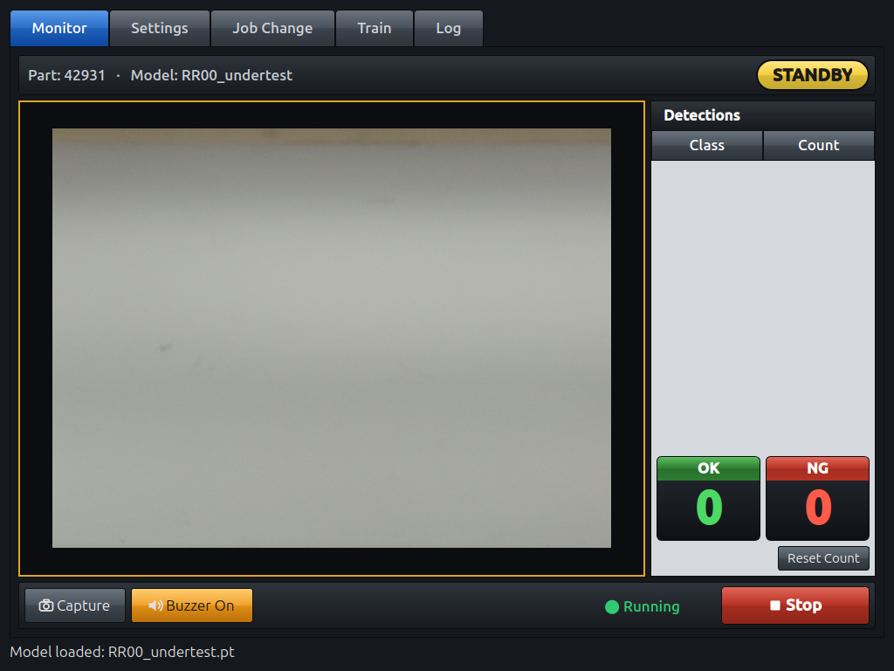
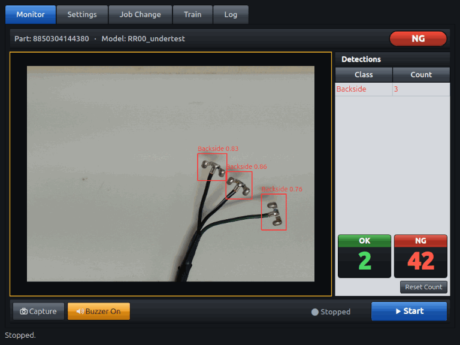
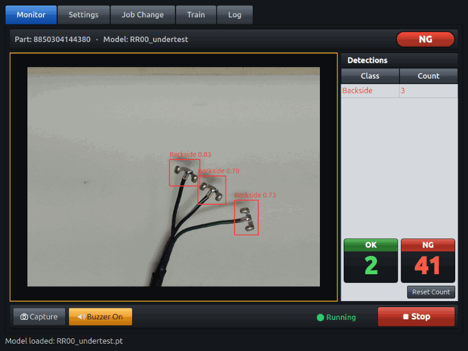
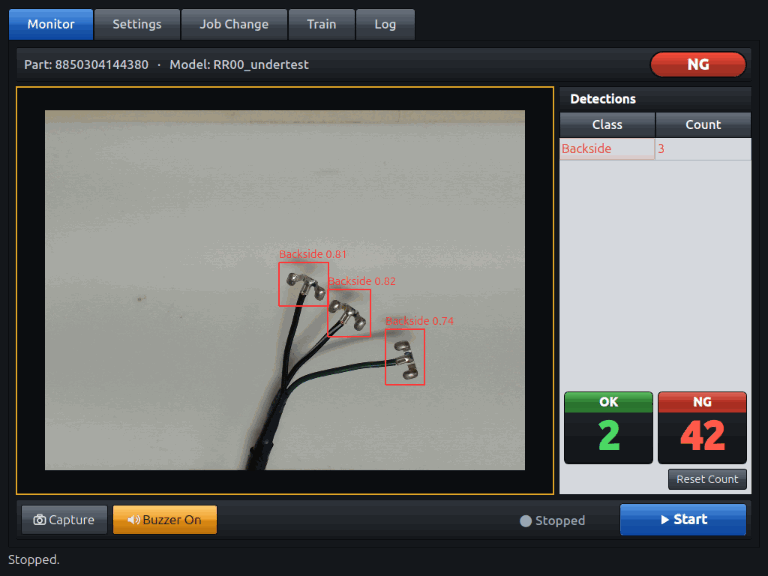
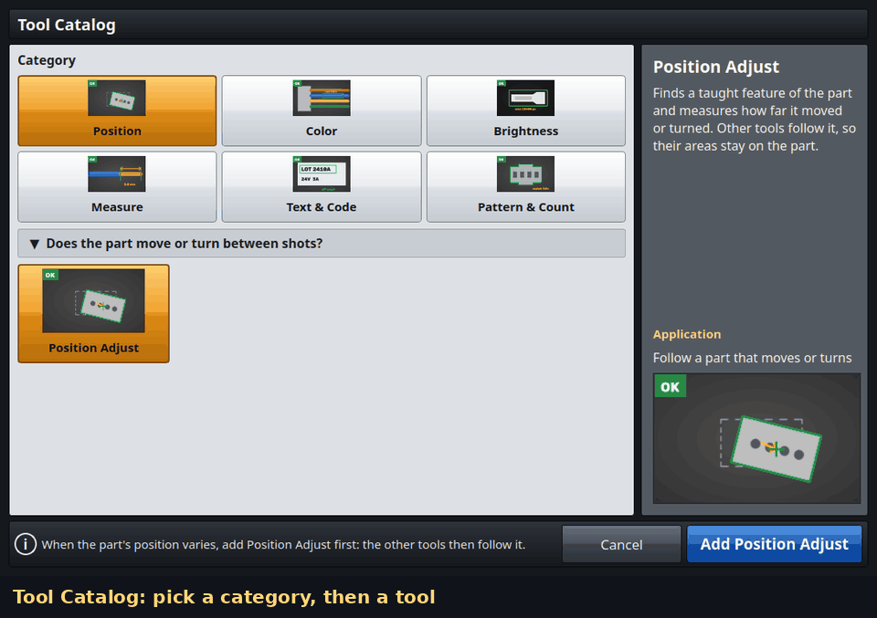
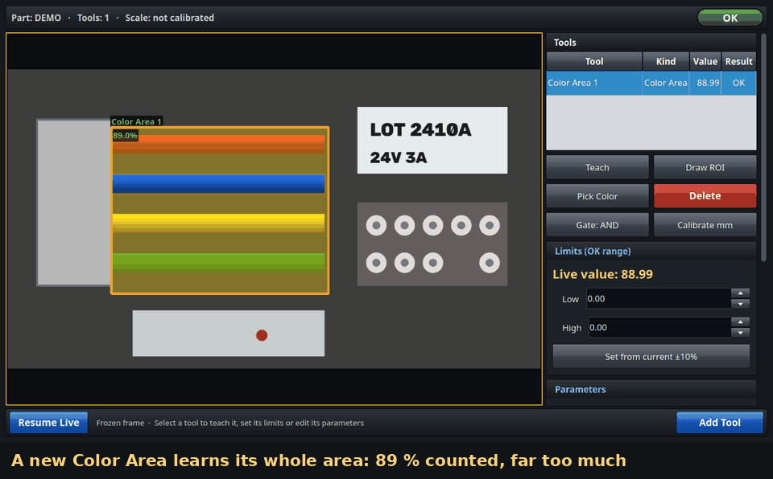
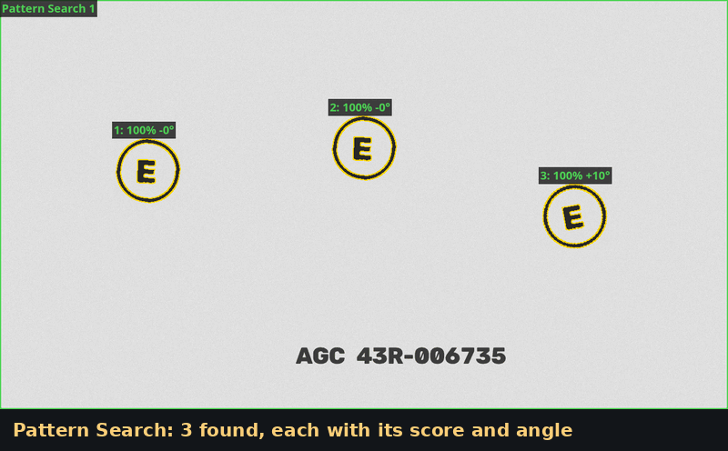
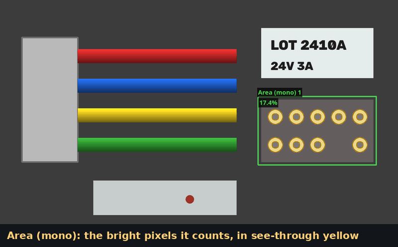
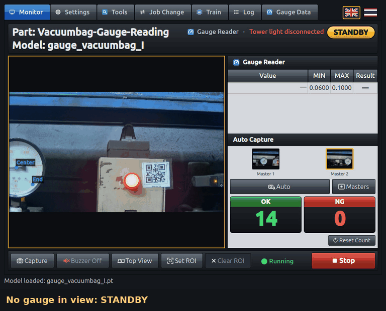
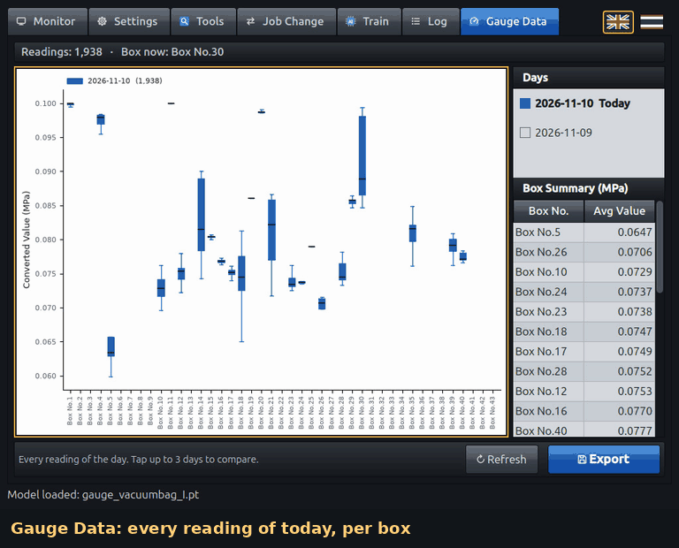

# UniversalV1 — Wire Harness Vision Inspection

**English** · [ภาษาไทย](#ภาษาไทย)

A Keyence-style inspection station for wire harnesses. A USB camera and a YOLO model decide **OK / NG / STANDBY**, and a PATLITE tower light and buzzer signal the result. It runs as a full-screen touch kiosk on an NVIDIA Jetson Orin Nano.



📘 **User manual:** [English](docs/USER_MANUAL_EN.md) · [ภาษาไทย](docs/USER_MANUAL_TH.md)

## See it in action

Recorded on the real station, with the live camera and a real harness.

| 1. Switch job by barcode | 2. Review NG pictures |
|---|---|
|  |  |
| **Job Change → Scan Barcode...**: hold the label on the red line. The part number is read, and the job is loaded or created. | **Log** tab: tap a thumbnail, pinch with two fingers to zoom on the detections, double-tap to fit. |
| **3. Adjust detection settings** | **4. Correct labels for training** |
|  |  |
| **Settings** tab: confidence, max detections and state hold time take effect immediately on the live view. | **Train** tab: pick an image, tap a box, choose the right class, **Confirm**. |

## Image-processing tools (Keyence IV4 / CV-X style)

Next to YOLO, each job can hold rule-based **vision tools**. They work like the tools of a Keyence IV4 / CV-X vision sensor: each one checks one thing in its own area of the image, and together they decide OK / NG (gate **AND** or **OR**, together with YOLO). They are set up in the **Tools** tab.

| 1. Tool Catalog | 2. Eyedropper (Pick Color / Pick Gray) |
|---|---|
|  |  |
| **Add Tool** opens the catalog. Tap a category, then a tool: the **Application Navigator** on the right explains it with an example. **Add** (or a double tap) confirms, then you drag the tool's area on the image. | Tap the color (or gray level) to count on the image, and tap more spots to add them. **− Narrower / + Wider** adjust it in steps. What is counted is shown live in yellow. |
| **3. Pattern Search** | **4. What each tool counts** |
|  |  |
| Teach one mark (drag a box around it). Every copy is then found at any angle and counted, with its score and angle. | Area, Edge Pixels, Blob Count and Color Prohibit show exactly the pixels they count: see-through yellow, or red for a forbidden color. |

| Category | Tools |
|---|---|
| Position | **Position Adjust**: finds the part, and the other tools follow it when it moves or turns |
| Color | **Color Area** (% of the taught color), **Color Average** (ΔE to the master), **Color Prohibit** (NG on a forbidden color) |
| Brightness | **Area (mono)**, **Brightness Average**, **Edge Pixels**, **Shading Uniformity** |
| Measure | **Width**, **Edge Presence**, **Pitch**, **Diameter** (px, or mm after **Calibrate mm**) |
| Text & Code | **OCR Text** (Tesseract), **Code QR / 1D** (zbar). They run at 2 Hz in their own thread, so the live view stays at full frame rate. |
| Pattern & Count | **Outline**, **Pattern Search** (ShapeTrax-style, any angle), **Blob Count** |

How to set up a tool:
1. **Tools** tab. The camera starts live; **Snapshot** freezes a frame and **Resume Live** goes back.
2. **Add Tool** → pick it in the catalog → drag its area on the image. Pattern Search then asks for a box around one copy of the pattern.
3. **Teach** (from the frozen frame), or **Pick Color / Pick Gray** for the color and brightness tools.
4. Set the OK range under **Limits**. **Set from current ±10 %** is a quick start. Tools are saved with the job and judged live on the Monitor tab.

The tool design and the per-tool details are in [core_function.md](core_function.md); the development log is in [develop_record.md](develop_record.md). The GIFs above are drawn scenes recorded offscreen by `tools/make_readme_gifs.py`.

## Gauge Reader

A job can judge a dial gauge instead of marks: **Settings > AI Model > Judge by > Gauge Reader**, then set the limits on the **Gauge Reader** page. It uses `weights/gauge_epoch-100.pt`, which finds the dial's Center, Start, End and needle Tip; the value comes from the needle's angle.

| 1. Reading and judging | 2. Comparing days |
|---|---|
|  |  |
| **Monitor** tab: the value is read from the needle and checked against MIN and MAX. Out of spec is NG, and the image is saved tagged OVER or UNDER. | **Gauge Data** tab: a box plot for each box from every reading of the day. Tap up to 3 days to compare them in different colours. |

These two GIFs use a drawn dial and made-up readings, with the dial's points supplied directly instead of found by the model. Everything after detection is the real app. Remake them with `tools/make_readme_gifs.py gauge`.

| Setting | Meaning |
|---|---|
| Value at Start / End | What the dial shows at the left / right end of its scale (default 0.1 and 0 MPa) |
| Unit | Shown after the value |
| MIN / MAX | The OK range, limits included |

- **In range:** OK. **Over MAX or under MIN:** NG, with tower light, buzzer, relay and NG count, like a missing Required Mark.
- **No reading** (any of the four points not found): STANDBY, never NG.
- **Images:** saved to the Log tab, annotated and tagged OVER or UNDER: one when it goes out of spec, and one more if it swings straight from OVER to UNDER or back. A gauge that stays out of spec saves nothing more.
- **Position check:** Start must be on the left of Center and End on its right, with the Tip between them. Position decides the name: a scale end the model calls End on the left is treated as Start, and the reverse. If no set of points fits, the job shows STANDBY with a note.
- **Measurement:** counted from End to Tip, where End to Start is 100%. With the default settings, End is 0 and Start is 0.1 MPa.
- **Gauge Data tab** (gauge jobs only): one reading a second is saved to `gauge_logs/<part>/YYYY_MM_DD_log.csv` (Timestamp, Converted Value, QR Code Data). The tab shows a box plot for Box No.1-43 and each box's average from every reading of the chosen day. Tap up to 3 days in the Days list to compare them side by side, one colour per day. **Export** copies a From-To date range to a USB drive, one CSV file per day, in a new `gauge_export/` folder. The box number comes from the QR label in view.
- Set an ROI around the gauge so it fills the model's view. If the camera is mounted upside down, turn on mirror and flip under Settings > Camera.

The Train tab's **Training Options** set the augmentation preset, flips and epochs, with a preview of what the trainer sees.

## Features

- **Live detection:** Ultralytics YOLO runs on the Jetson GPU (CUDA). You can filter by confidence, class and a maximum number of detections.
- **Judgement and outputs:**
  - OK / NG / STANDBY, using one or two target classes combined with AND / OR.
  - PATLITE LR6-USB tower light: green = OK, red = NG, yellow = STANDBY.
  - NG alarm buzzer, with a short beep on OK.
  - A state hold time (default 1 s) stops the light and buzzer from flickering.
- **OK / NG cycle counters:** large tiles that are saved across restarts.
- **Log tab:**
  - Every NG is saved as an image, grouped by part number.
  - Thumbnails open a full-screen view with pinch-to-zoom.
- **Job Change:**
  - One job per part number stores the model, filters and target classes.
  - Jobs are switched with touch tiles or a barcode scanned by the camera (Code 39 / AIM extended).
- **Capture and Train:**
  - **Capture** saves frames with YOLO labels.
  - The Train tab lets you draw, delete and correct boxes, and fine-tune the model on the device.
  - **Training Options**: augmentation preset (Off / Light / Strong), mirror and upside-down flips (off by default), epochs, and a preview of the images exactly as the trainer sees them.
- **Kiosk mode:**
  - Starts full screen on boot through a systemd user service.
  - Reloads the last job automatically.

## Hardware

| Item | Used here |
|---|---|
| Computer | NVIDIA Jetson Orin Nano (JetPack, CUDA 13) |
| Camera | USB UVC camera (V4L2) |
| Tower light | PATLITE LR6-USB (VID `191a`, PID `8003`) |
| Display | 1024×768 touch panel (ILITEK multi-touch) |

## Installation

On a Jetson Orin Nano (Ubuntu 24.04 / JetPack, CUDA 13), the installer does everything in a checked order and sets up the start at boot:

```bash
git clone git@github.com:natn2014/UniversalV1.git ~/dev/UniversalV1
cd ~/dev/UniversalV1
git checkout imageprocessing
# copy the model files that are not in git, e.g. weights/MarkV9_best.pt
./deploy/install.sh
sudo reboot
```

Run it as the user the kiosk runs as, not with `sudo`; it asks for the sudo password itself. **See [deploy/INSTALL.md](deploy/INSTALL.md)** for the 12 steps, resuming after a failure (`--from N`), checking an install (`--check`) and the day-to-day commands.

What it sets up, in this order:
- **System packages:** zbar, Tesseract, the Qt/X11 libraries and fonts with Thai.
- **The tower light's udev rule.**
- **Python packages:** PyTorch with CUDA (first, checked on the GPU), OpenCV *headless*, Ultralytics, PySide6 and the OCR modules. Versions are pinned in `deploy/constraints-jetson.txt`.
- **Power mode 25 W.**
- **Start at boot:** automatic login and the `universalv1` service.

> Install `opencv-python-headless`, not `opencv-python`. The non-headless build brings its own Qt plugins, and they clash with PySide6. The installer removes the `opencv-python` that Ultralytics pulls in.

## Running

After the install and a reboot, the app starts by itself: the desktop logs in, the app opens full screen, loads the last job and starts inspecting.

To run it by hand (with the service stopped):

```bash
systemctl --user stop universalv1
.venv/bin/python main.py
```

Choose a model and camera in **Settings**, or pick a job in **Job Change**. Inspection starts on its own when the app opens with a job (Settings > Camera > *Start inspecting when the app opens*), or press **Start** on the Monitor tab.

## Start at boot (kiosk)

`./deploy/install.sh` sets this up (step 12): GDM automatic login, no screen lock, and the systemd user service `universalv1`. The service starts `deploy/run_app.sh` with the desktop session and restarts the app if it crashes.

```bash
systemctl --user status  universalv1    # running?
systemctl --user restart universalv1    # restart the app
systemctl --user stop    universalv1    # stop it (e.g. before running main.py by hand)
journalctl --user -u universalv1 -f     # service messages
tail -f logs/app.log                    # the app's output
./deploy/install.sh --check             # what is installed / missing
./deploy/install.sh --remove-service    # no more auto start
```

Only one copy of the app runs at a time: a second start says "already running" and exits (the camera and tower light can only be used by one).

## Project layout

| Path | Purpose |
|---|---|
| `main.py` | Entry point (`python3 main.py`); the application lives in `app/` |
| `app/main_window.py` | Main window: hosts the tabs and the cross-tab flows (switching jobs, barcode scan, shutdown) |
| `app/tabs/` | One widget per tab: Monitor, Settings, Tools, Job Change, Train, Log |
| `app/vision/` | Rule-based vision tools (no Qt): position, color, brightness, measure, OCR / code, outline, pattern search, blob count; the slow-tool thread and the total judgement |
| `app/context.py` | `AppContext`: state the tabs share (video worker, filters, current part, model, settings, tower light) |
| `app/camera.py`, `app/tower.py`, `app/judgement.py` | Camera + YOLO worker, tower light/buzzer controller, OK/NG decision and hold-time latch |
| `app/jobs.py`, `app/ng_log.py`, `app/settings.py`, `app/paths.py` | Saved jobs, NG image log, `app_settings.json`, data paths |
| `app/widgets/`, `app/theme.py` | Reusable widgets and dialogs; dark industrial stylesheet and icons |
| `patlite_lr6.py` | PATLITE LR6-USB driver (from [TowerLightUSB](https://github.com/natn2014/TowerLightUSB)) |
| `part_configs/<part>.json` | Saved jobs, one per part number |
| `*.pt`, `weights/` | YOLO models |
| `deploy/` | Installer (`install.sh`, guide `INSTALL.md`), pinned versions, the `universalv1` service and its launcher, tower light udev rule |
| `docs/` | User manuals, screenshots and demo GIFs (`docs/gifs/`) |
| `tools/record_demo_gifs.py` | Re-records the demo GIFs from the running app (live camera; uses scratch copies of all data) |
| `tools/make_tool_thumbs.py`, `tools/make_readme_gifs.py` | Draw the Tool Catalog example pictures (`app/assets/tool_thumbs/`) and record the vision-tool GIFs offscreen |
| `tools/code39.py` | Code 39 / Code 39 Extended label renderer (mock labels for demos and tests) |
| `.claude/skills/industrial-hmi-ui/` | Claude Code skill: this app's UI/UX design system (theme module `industrial_theme.py`, layout recipes) for reuse in other apps |
| `app_settings.json` *(runtime)* | Buzzer, hold time and OK/NG counters (git-ignored) |
| `ng_logs/` *(runtime)* | NG images, `ng_logs/<part>/<timestamp>.jpg` (git-ignored) |
| `captures/` *(runtime)* | **Capture** images and YOLO labels (git-ignored) |

## Troubleshooting

| Symptom | Check |
|---|---|
| "Tower Light: Not Connected" | Check the USB cable and the udev rule (`./deploy/install.sh --check`; install it with `--from 3`). Make sure no other copy of the app is running. |
| Camera does not open | Another process is using it: the service, a second app, or the barcode dialog. Stop it, then press **Scan Cameras** in Settings. |
| App restarts in a loop after boot | Run `journalctl --user -u universalv1` and look at `logs/app.log`. |
| App does not start after boot | `./deploy/install.sh --check`: automatic login and the service must both be on (`--from 12`). |
| First Start takes about 10 s | Normal. The GPU compiles its kernels on the first inference (Orin is compute capability 8.7). |
| Training is killed | The device ran out of RAM. Training already uses batch 8 and workers 0. Close other programs and stop the Monitor stream. |

---

## ภาษาไทย

[English](#universalv1--wire-harness-vision-inspection) · **ภาษาไทย**

ระบบตรวจสอบชุดสายไฟ (Wire Harness) ด้วยกล้อง ออกแบบหน้าจอแบบ Keyence ใช้กล้อง USB ร่วมกับโมเดล YOLO ตัดสินผล **OK / NG / STANDBY** และแสดงผลผ่านไฟสัญญาณ (Tower Light) PATLITE พร้อมเสียงเตือน ทำงานแบบเต็มจอ (Kiosk) บนจอสัมผัส ด้วยบอร์ด NVIDIA Jetson Orin Nano

📘 **คู่มือการใช้งาน:** [English](docs/USER_MANUAL_EN.md) · [ภาษาไทย](docs/USER_MANUAL_TH.md)

### ตัวอย่างการใช้งาน

บันทึกจากเครื่องจริง ด้วยกล้องจริงและชิ้นงานจริง

| 1. เปลี่ยนงานด้วยบาร์โค้ด | 2. ดูภาพ NG ย้อนหลัง |
|---|---|
|  |  |
| **Job Change → Scan Barcode...** ถือฉลากไว้บนเส้นสีแดง ระบบอ่านรหัสชิ้นงาน แล้วโหลดงานหรือสร้างงานใหม่ | แท็บ **Log** แตะภาพย่อ ใช้ 2 นิ้วซูมที่จุดที่ตรวจพบ แตะ 2 ครั้งให้พอดีจอ |
| **3. ปรับค่าการตรวจจับ** | **4. แก้ไข Label สำหรับเทรน** |
|  |  |
| แท็บ **Settings** ค่า Confidence, Max Detections และ State hold time มีผลกับภาพสดทันที | แท็บ **Train** เลือกภาพ แตะกรอบ เลือกคลาสที่ถูกต้อง แล้วกด **Confirm** |

### เครื่องมือประมวลผลภาพ (แบบ Keyence IV4 / CV-X)

นอกจาก YOLO แล้ว แต่ละงานสามารถมี **เครื่องมือตรวจสอบภาพ** แบบกฎ (rule-based) ได้ เหมือนเครื่องมือของเซนเซอร์ภาพ Keyence IV4 / CV-X เครื่องมือแต่ละตัวตรวจสิ่งเดียวในพื้นที่ของตัวเอง แล้วรวมผลเป็น OK / NG (แบบ **AND** หรือ **OR** ร่วมกับ YOLO) ตั้งค่าได้ที่แท็บ **Tools**

| 1. Tool Catalog | 2. ดูดสี (Pick Color / Pick Gray) |
|---|---|
|  |  |
| กด **Add Tool** เลือกหมวด แล้วเลือกเครื่องมือ ช่อง **Application Navigator** ด้านขวาอธิบายพร้อมภาพตัวอย่าง กด **Add** (หรือแตะ 2 ครั้ง) แล้วลากพื้นที่บนภาพ | แตะสี (หรือระดับความสว่าง) ที่ต้องการนับบนภาพ แตะจุดอื่นเพิ่มได้ ปรับด้วย **− Narrower / + Wider** ส่วนที่นับจะแสดงเป็นสีเหลืองทันที |
| **3. Pattern Search** | **4. สิ่งที่เครื่องมือนับ** |
|  |  |
| สอนเครื่องหมาย 1 ตัว (ลากกรอบรอบมัน) ระบบจะค้นหาทุกตัวได้ทุกมุม พร้อมนับจำนวน คะแนน และมุม | Area, Edge Pixels, Blob Count และ Color Prohibit แสดงพิกเซลที่นับจริง เป็นสีเหลืองโปร่ง หรือสีแดงสำหรับสีต้องห้าม |

รายละเอียดเครื่องมือทั้งหมดอยู่ใน [core_function.md](core_function.md)

### การอ่านเกจ (Gauge Reader)

ตั้งค่าได้ที่ **ตั้งค่า > โมเดล AI > ตัดสินโดย > อ่านเกจ** แล้วกำหนดค่าในหน้า **อ่านเกจ** โปรแกรมใช้โมเดล `weights/gauge_epoch-100.pt`

| 1. การอ่านค่าและตัดสินผล | 2. เปรียบเทียบข้อมูลแต่ละวัน |
|---|---|
|  |  |
| แท็บ **Monitor** อ่านค่าจากเข็มแล้วเทียบกับ MIN และ MAX หากเกินช่วงจะเป็น NG และบันทึกภาพพร้อมป้าย OVER หรือ UNDER | แท็บ **Gauge Data** แสดง Box plot ของแต่ละกล่องจากทุกค่าของวัน แตะเลือกได้สูงสุด 3 วันเพื่อเปรียบเทียบด้วยสีที่ต่างกัน |

GIF ทั้งสองนี้ใช้หน้าปัดที่วาดขึ้นและข้อมูลสมมติ โดยป้อนตำแหน่งจุดบนหน้าปัดให้โดยตรง ไม่ได้ให้โมเดลตรวจจับ ขั้นตอนหลังการตรวจจับทั้งหมดเป็นโปรแกรมจริง

- ค่าอยู่ระหว่าง MIN ถึง MAX (รวมค่าขอบ): OK
- เกิน MAX หรือต่ำกว่า MIN: NG พร้อมไฟสัญญาณ เสียงเตือน รีเลย์ และตัวนับ NG
- อ่านค่าไม่ได้: STANDBY ไม่นับเป็น NG
- ตรวจตำแหน่ง: Start ต้องอยู่ทางซ้ายของ Center และ End ต้องอยู่ทางขวา โดยใช้ตำแหน่งเป็นตัวกำหนดชื่อ หากโมเดลตรวจพบ End ทางซ้ายจะถือเป็น Start และในทางกลับกัน
- ส่งออกข้อมูล: แท็บ **Gauge Data** กด **Export** เลือกวันที่เริ่มต้น วันที่สิ้นสุด และไดรฟ์ USB ระบบคัดลอกไฟล์ CSV วันละ 1 ไฟล์ไปยังโฟลเดอร์ใหม่ `gauge_export/`
- การวัด: นับจาก End ไปยัง Tip โดย End ถึง Start เท่ากับ 100% ค่าเริ่มต้นคือ End = 0 และ Start = 0.1 MPa
- บันทึกภาพลงแท็บ Log พร้อมป้าย OVER หรือ UNDER เมื่อค่าออกนอกช่วง 1 ภาพ และอีก 1 ภาพเมื่อค่าเปลี่ยนจาก OVER เป็น UNDER หรือกลับกันโดยตรง

### ความสามารถหลัก

- **ตรวจจับแบบเรียลไทม์:** ใช้ Ultralytics YOLO บน GPU ของ Jetson (CUDA) กรองผลได้ตามค่าความมั่นใจ (Confidence) คลาส และจำนวนสูงสุดที่ตรวจจับ
- **การตัดสินผลและสัญญาณ:**
  - ตัดสิน OK / NG / STANDBY จากคลาสเป้าหมาย 1–2 คลาส (เงื่อนไข AND / OR)
  - ไฟสัญญาณ PATLITE LR6-USB: เขียว = OK, แดง = NG, เหลือง = STANDBY
  - Buzzer เตือนเมื่อ NG และเสียงบี๊บสั้นเมื่อ OK
  - มีเวลาคงสถานะ (ค่าเริ่มต้น 1 วินาที) ป้องกันไฟและเสียงกะพริบไปมา
- **ตัวนับรอบ OK / NG:** ตัวเลขขนาดใหญ่ ค่าไม่หายเมื่อรีสตาร์ท
- **แท็บ Log:**
  - บันทึกภาพทุกครั้งที่เกิด NG แยกตามรหัสชิ้นงาน
  - แตะภาพย่อเพื่อดูภาพเต็มจอ และซูมด้วย 2 นิ้วได้
- **เปลี่ยนงาน (Job Change):**
  - งาน 1 งานต่อรหัสชิ้นงาน เก็บโมเดล ค่ากรอง และคลาสเป้าหมาย
  - เลือกงานด้วยปุ่มบนจอ หรือสแกนบาร์โค้ดผ่านกล้อง (Code 39 / AIM extended)
- **Capture และ Train:**
  - ปุ่ม **Capture** บันทึกภาพพร้อม Label รูปแบบ YOLO
  - แท็บ Train ใช้วาด ลบ และแก้ไขคลาสของกรอบ และเทรนโมเดลต่อ (Fine-tune) บนเครื่องได้
  - **Training Options:** เลือก Augmentation (Off / Light / Strong), กลับภาพซ้าย-ขวา / บน-ล่าง (ปิดไว้เป็นค่าเริ่มต้น), จำนวน Epoch และดูตัวอย่างภาพที่ใช้เทรนจริง
- **โหมด Kiosk:**
  - เปิดเต็มจอเองเมื่อบูตเครื่อง ผ่าน systemd user service
  - โหลดงานล่าสุดให้อัตโนมัติ

### อุปกรณ์

| อุปกรณ์ | รุ่นที่ใช้ |
|---|---|
| คอมพิวเตอร์ | NVIDIA Jetson Orin Nano (JetPack, CUDA 13) |
| กล้อง | กล้อง USB แบบ UVC (V4L2) |
| ไฟสัญญาณ | PATLITE LR6-USB (VID `191a`, PID `8003`) |
| จอแสดงผล | จอสัมผัส 1024×768 (ILITEK รองรับหลายนิ้ว) |

### การติดตั้ง

บน Jetson Orin Nano (Ubuntu 24.04 / JetPack, CUDA 13) ใช้สคริปต์ติดตั้ง ซึ่งติดตั้งทีละขั้นตามลำดับที่ตรวจสอบแล้ว และตั้งค่าให้เปิดโปรแกรมเองเมื่อบูตเครื่อง:

```bash
git clone git@github.com:natn2014/UniversalV1.git ~/dev/UniversalV1
cd ~/dev/UniversalV1
git checkout imageprocessing
# คัดลอกไฟล์โมเดลที่ไม่อยู่ใน git เช่น weights/MarkV9_best.pt
./deploy/install.sh
sudo reboot
```

ให้รันด้วยผู้ใช้ที่ใช้งานเครื่อง (ไม่ต้องใส่ `sudo` สคริปต์จะถามรหัสผ่านเอง) **ดูรายละเอียดใน [deploy/INSTALL.md](deploy/INSTALL.md)** ทั้ง 12 ขั้นตอน การติดตั้งต่อหลังแก้ปัญหา (`--from N`) และการตรวจสอบ (`--check`)

### การเปิดใช้งาน

หลังติดตั้งและรีบูต โปรแกรมจะเปิดเอง (Login อัตโนมัติ เปิดเต็มจอ โหลดงานล่าสุด และเริ่มตรวจทันที)

เปิดเองด้วยมือ (หยุด service ก่อน):

```bash
systemctl --user stop universalv1
.venv/bin/python main.py
```

### เปิดโปรแกรมอัตโนมัติเมื่อบูตเครื่อง (Kiosk)

`./deploy/install.sh` ตั้งค่าให้แล้ว (ขั้นที่ 12): Login อัตโนมัติ ไม่ล็อกหน้าจอ และ service `universalv1`

คำสั่งที่ใช้บ่อย:

```bash
systemctl --user status  universalv1    # ดูสถานะ
systemctl --user restart universalv1    # รีสตาร์ทโปรแกรม
systemctl --user stop    universalv1    # หยุดก่อนเปิด main.py เอง
journalctl --user -u universalv1 -f     # ดู Log ของ service
tail -f logs/app.log                    # ดู Log ของโปรแกรม
./deploy/install.sh --check             # ตรวจว่าติดตั้งครบหรือไม่
```

> โปรแกรมเปิดได้ครั้งละ 1 ตัว ถ้าเปิดซ้ำจะแจ้งว่า "already running" แล้วปิดตัวเอง (กล้องและไฟสัญญาณใช้ได้ครั้งละโปรแกรมเดียว)

### การแก้ปัญหาเบื้องต้น

| อาการ | วิธีตรวจสอบ |
|---|---|
| "Tower Light: Not Connected" | ตรวจสาย USB และกฎ udev (`./deploy/install.sh --check` ติดตั้งด้วย `--from 3`) และตรวจว่าไม่มีโปรแกรมอื่นเปิดค้างอยู่ |
| ไม่เปิดเองหลังบูต | `./deploy/install.sh --check` ต้องเปิด Login อัตโนมัติและ service (`--from 12`) |
| กล้องไม่เปิด | มีโปรแกรมอื่นใช้กล้องอยู่ (service, โปรแกรมที่เปิดซ้อน หรือหน้าต่างสแกนบาร์โค้ด) ให้ปิดก่อน แล้วกด **Scan Cameras** ในหน้า Settings |
| กด Start ครั้งแรกช้าประมาณ 10 วินาที | เป็นเรื่องปกติ GPU ต้องคอมไพล์ในการประมวลผลครั้งแรก |
| โปรแกรมถูกปิดระหว่างเทรน | หน่วยความจำ (RAM) ไม่พอ ให้หยุด Monitor และปิดโปรแกรมอื่นก่อนเทรน |
